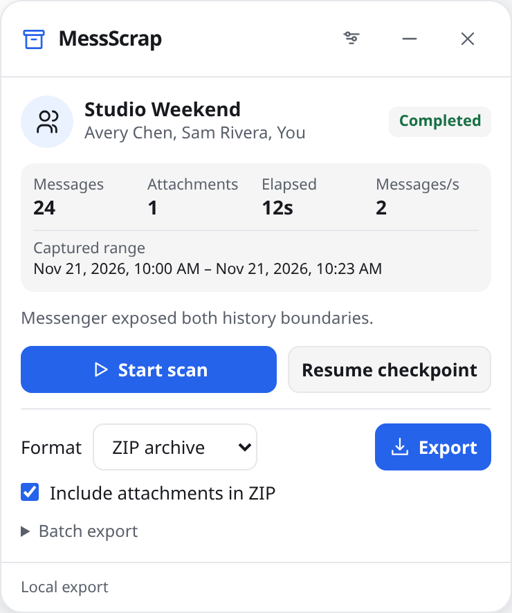
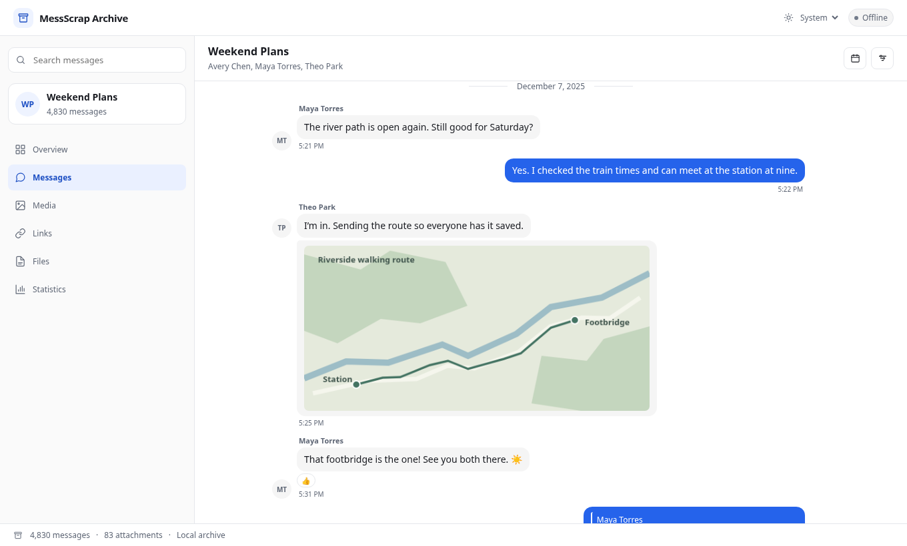
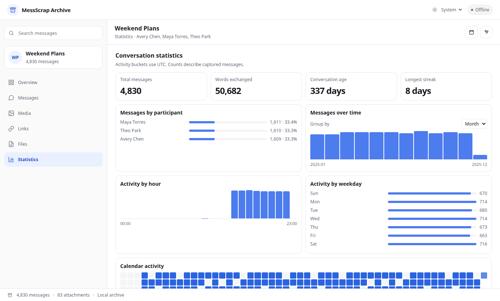

<p align="center">
  
</p>

<h1 align="center">MessScrap</h1>

<p align="center"><strong>Your conversations. Your data. Your archive.</strong></p>
<p align="center">Save Messenger conversations to files you can browse, search, and keep offline.</p>

<p align="center">
  <a href="https://github.com/Refilewski/MessScrap/releases"></a>
  <a href="https://github.com/Refilewski/MessScrap/actions"></a>
  <a href="#license"></a>
  <a href="#platforms"></a>
  <a href="#platforms"></a>
  <a href="#platforms"></a>
</p>

<p align="center">
  <a href="#installation">Install</a> ·
  <a href="#quick-start">Quick start</a> ·
  <a href="#archive-viewer">Archive viewer</a> ·
  <a href="docs/CLI.md">CLI reference</a> ·
  <a href="#development">Development</a> ·
  <a href="#license">License</a>
</p>

**Mobile:** Android (Firefox, experimental) · iOS (Orion, experimental). Both can open exported offline archives; live capture is not guaranteed on mobile. See [platforms](#platforms).

MessScrap collects messages in a conversation you open and unlock in Messenger. Keep a compact transcript, build a self-contained archive with media, or use the terminal to search, validate, and update existing archives. Capture, processing, and storage run locally through your browser session and filesystem.

## Features

- **Capture with status and recovery.** Follow the conversation, captured date range, attachment count, and termination reason. Pause, resume, or cancel a scan, and continue from an optional local checkpoint.
- **Offline archive viewer.** Browse the conversation and filter messages, media, links, and files. Follow captured replies, jump to a date, and inspect conversation activity.
- **Shared export formats.** Produce TXT, JSON, CSV, HTML, or a ZIP with the viewer, transcripts, metadata, and analytics.
- **Local archive tools.** Import older MessScrap JSON or compatible Messenger exports, validate archive data, and merge overlapping captures while retaining history.

## Platforms

| | Browser extension | CLI |
| --- | --- | --- |
| Runtime | Chrome and Brave on desktop, Firefox 140+ on desktop | Node.js on Windows, macOS, or Linux |
| Live capture | Active Messenger tab | Local Chrome, Brave, Chromium, or Edge session |
| Scan controls | In-page panel | Terminal status and keyboard controls |
| Checkpoints | Browser-local storage | Local files |
| Exports | TXT, JSON, CSV, HTML, ZIP | TXT, JSON, CSV, HTML, ZIP |
| Offline viewer and charts | Included in HTML and ZIP | Included in HTML and ZIP |
| Batch export | Select visible conversations in the panel | Select visible conversation IDs or provide existing archives |
| Archive operations | Update a conversation from an existing JSON archive | Import, validate, search, statistics, and update |

**Mobile live capture is experimental, not officially verified for all devices.** There is no native Android or iOS app and no mobile CLI. The offline archive viewer is designed for mobile browsers.

<details>
<summary>Android (Firefox) and iOS (Orion) installation notes</summary>

Firefox 142+ on Android uses Mozilla's USB debugging workflow for development installation. Request Messenger's desktop site if the mobile page does not expose the message list. The Chromium build can be tried in Orion's Chrome-extension compatibility mode on iOS. Browser and mobile Messenger changes can affect capture, downloads, and checkpoint storage. [Firefox Android extension development](https://extensionworkshop.com/documentation/develop/developing-extensions-for-firefox-for-android/) · [Orion](https://browser.kagi.com/orion/)

</details>

## Installation

Download assets from GitHub Releases when a 2.0 package is available, or build this checkout with the commands in [Development](#development). The older `v0.2.x` assets use the original CLI and extension. [GitHub Releases](https://github.com/Refilewski/MessScrap/releases)

### Browser extension

1. Extract the Chromium or Firefox build to a folder.
2. In Chrome or Brave, open the browser's extensions page, enable **Developer mode**, select **Load unpacked**, and choose the extracted folder.
3. In Firefox, open `about:debugging#/runtime/this-firefox`, select **Load Temporary Add-on**, and choose the extracted `manifest.json`. Firefox requires Mozilla signing for persistent installation in standard release builds.

### CLI

Install the versioned tarball with Node.js 22.11 or later.

```sh
npm install -g ./messscrap-2.0.0.tgz
messscrap --version
```

Install Chrome, Brave, Chromium, or Edge if you plan to capture live conversations. The offline commands work without a browser.

## Quick start

### From Messenger

1. Open a specific conversation and unlock its history if Messenger prompts you.
2. Select **MessScrap → Open panel**. Confirm the conversation title and participants.
3. Start capture. You can pause, resume, or cancel while the panel is open.
4. Select **ZIP** and include attachments to archive available media. Extract the downloaded ZIP and open `index.html`. Select **HTML** to save the viewer alone.

Use **Scan settings** to save local checkpoints, adjust the round limit, or scan toward older messages from the current scroll position. Open **Batch export** to select visible conversations and generate individual ZIPs or a combined archive index.

<p align="center">
  
</p>

### From a terminal

```console
$ messscrap --version
2.0.0
$ messscrap scan --checkpoint --format zip --media --output ./archives
$ messscrap validate ./archives/conversation.zip
$ messscrap search ./archives/conversation.zip "weekend"
$ messscrap stats ./archives/conversation.zip --format csv
```

The archive path comes from the scan output. Keep the isolated capture browser open, sign in there if needed, and select a conversation before continuing the scan.

<details>
<summary>See a validation result for synthetic data</summary>

```console
$ messscrap validate weekend-plans.json
Warning: Coverage is partial or unconfirmed.
Valid archive. 1000 messages.
```

The captured data passed validation. The coverage warning records uncertainty about the original conversation history.

</details>

| Command | Use it to |
| --- | --- |
| `messscrap scan --resume` | Continue an existing checkpoint for the active conversation. |
| `messscrap export archive.json --format html` | Build a standalone local viewer from an existing archive. |
| `messscrap update archive.json` | Combine an existing archive with a new overlapping capture. |
| `messscrap import messenger.json` | Convert a compatible older or official Messenger JSON export. |
| `messscrap validate archive.json --json` | Check schema and referenced media and emit machine-readable results. |
| `messscrap stats archive.json --format json` | Calculate conversation statistics. |
| `messscrap search archive.json "weekend"` | Find matches in the archive from a terminal. |
| `messscrap --help` | View command options. |

See the [CLI reference](docs/CLI.md) for batch exports, checkpoint management, browser selection, and the migration from the Python CLI.

## Archive viewer

Open the HTML file directly from a local folder. The viewer keeps the conversation at the center, with a searchable sidebar, date navigation, and dedicated media, links, files, and statistics views. On a phone, the sidebar collapses to keep the conversation readable.

<p align="center">
  
</p>

Statistics cover participation, message length, activity over time, response-time estimates, frequently used words and emoji, and attachment, link, and reaction counts. The charts use captured data. Filters apply to the data shown in the dashboard. [How metrics are calculated](docs/ARCHITECTURE.md#statistics)

<p align="center">
  
</p>

## Export formats

| Format | Contents |
| --- | --- |
| **TXT** | Readable transcript grouped by date and speaker. Internal IDs and raw URLs are omitted. |
| **JSON** | Versioned messages, conversation metadata, and scan status. |
| **CSV** | Message rows for spreadsheet use, with spreadsheet formula protection. |
| **HTML** | Standalone offline viewer with messages, search, and conversation statistics. Include neighboring local media files when the archive references them. |
| **ZIP** | Viewer, TXT/JSON/CSV, metadata, statistics, manifest, and media when available. Extract the ZIP before opening the viewer. |

The ZIP manifest records which attachments were saved, skipped, unavailable, or failed. Messenger controls which attachment URLs are available to the signed-in browser. Open an attachment in Messenger before capture if it has yet to load. An expired or restricted source can still appear in the transcript as a record of what Messenger showed.

Minimize the extension panel to keep the current scan running. Reopen it from the toolbar. A failed retry keeps the previous capture available while its conversation can still be verified.

### Update an archive

Keep the original archive and capture an overlap with recent history. In the extension, open **Scan settings → Update an archive** and choose the existing JSON from the same conversation. In the CLI, run `messscrap update archive.json` for live capture or pass `--from newer.json` to merge a capture you already made. MessScrap generates a new output and reports additions, updates, unchanged messages, conflicts, and whether coverage remains uncertain.

## Local-first operation

MessScrap reads messages available in your signed-in browser. Archives and checkpoints stay on your device. The viewer embeds its JavaScript, styles, and data and reads archived media from relative paths. Use a link's open control when you want to visit that site.

Archive files can contain private conversation text and media. Use synthetic data for bug reports, demos, and tests. [Archive internals and data handling](docs/ARCHITECTURE.md)

## Known limitations

- Messenger decides what the browser can see. A stable scroll position can leave the capture **Partial** when the true boundary is unknown.
- A conversation switch invalidates the active scan. Where Messenger does not provide enough evidence that its message list has caught up with the route, wait for the target conversation to load or reload it directly.
- Some message IDs, timestamps, sender names, and attachment URLs may be missing. Ambiguous matches can leave extra records in the archive.
- Browser capture follows Messenger's visible message list. Locked history, unavailable media, and layout changes can limit capture.
- Media transfer limits each attachment to 64 MiB and the saved media in each conversation archive to 512 MiB. ZIP assembly uses memory while preparing the download.
- Official Messenger JSON import depends on the export variant. Import separately split conversation files individually and review the resulting order and media paths.

<details>
<summary>Troubleshooting</summary>

| Symptom | What to check |
| --- | --- |
| Panel is waiting for the conversation | Open a specific thread, wait for the message list and title to settle, or reload the thread directly. |
| Scan found no messages | Confirm history is unlocked and visible in the browser. On mobile, try Messenger's desktop site. |
| An attachment is unavailable | Check the manifest. Reopen the conversation and load the attachment before another capture. |
| HTML opens but media is unavailable | Extract the complete ZIP and keep `media/` alongside `index.html`. |
| CLI cannot connect | Close the isolated MessScrap browser and re-run the command, or check the documented browser path and debugging port. |
| Installed CLI reports an older version | Install the 2.0 tarball and check which `messscrap` executable your shell resolves. |

</details>

## Development

Use Node.js 22.11 or later and Python 3.10 or later for extension packaging.

```sh
git clone https://github.com/Refilewski/MessScrap.git
cd MessScrap
npm ci
npm test
python3 extension/build.py --target all
npm run pack:cli
```

The extension builder writes browser folders and ZIPs under `bin/`. On Windows, use `py -3 extension/build.py --target all` if the interpreter is available through the Python launcher. [Release guide](docs/RELEASING.md) · [Benchmarks](docs/benchmarks.md) · [Changelog](CHANGELOG.md)

### Feedback and contributions

Open an issue with the MessScrap version, browser, platform, scan mode, and a synthetic reproduction. Code contributions to the official repository require maintainer permission; the [license](LICENSE) does not permit public redistribution of modified copies. [Issues](https://github.com/Refilewski/MessScrap/issues)

### Roadmap

- Expand the set of verified Messenger layouts, especially mobile and group conversations.
- Improve boundary evidence and attachment availability reporting as Messenger changes.
- Extend performance and recovery coverage for very large captures.

## License

**Source-available · Private/internal use · No redistribution.** You may download and run MessScrap and make changes **only for your own private, local use**. You may **not** republish, share, sell, redistribute, rebrand, or host the software for others, whether original or modified, without written permission. Linking to the official repository or releases is allowed.

Read the full [MessScrap Source-Available License](LICENSE). **This is not an open-source license.** The license covers the software, not your exported conversation archives.
