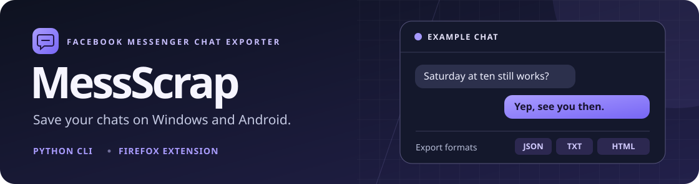

<p align="center">
  
</p>

<h1 align="center">MessScrap</h1>
<p align="center"><strong>Facebook Messenger Chat Exporter</strong></p>

<p align="center">
  <a href="#browser-extensions">Browser extensions</a> ·
  <a href="#windows-cli">Windows CLI</a> ·
  <a href="#what-gets-exported">Export formats</a>
</p>

MessScrap saves a conversation you open in Messenger. It scrolls in both directions to collect available history, preserves messages with identical text, and saves what it has collected if you stop early. Timestamps, replies, reactions, read indicators, links and attachment metadata are included when Messenger exposes them.

| Version | Where it runs | Output |
| --- | --- | --- |
| Browser extension | Chrome and Brave on desktop, Firefox on desktop and Android | JSON |
| Python CLI | Windows with Chrome or Brave | JSON, TXT and offline HTML, with optional attachment downloads |

## Browser extensions

Clone the repository and build the extensions with Python 3.10 or newer. The build does not require Selenium.

```powershell
git clone https://github.com/Refilewski/MessScrap.git
cd MessScrap
python extension/build.py
```

The builder creates `bin/chromium-extension/` for Chrome and Brave and `bin/firefox-extension/` for Firefox, along with a ZIP for each. Use `--target chromium` or `--target firefox` to build one package.

### Chrome and Brave on desktop

1. Open `chrome://extensions` in Chrome or `brave://extensions` in Brave.
2. Enable **Developer mode**, select **Load unpacked**, and choose `bin/chromium-extension`.
3. Open and unlock a conversation on Facebook Messenger.
4. Select **MessScrap → Open panel → Collect history → Save JSON**.

[Chrome installation guide](https://developer.chrome.com/docs/extensions/get-started/tutorial/hello-world#load-unpacked) · [Brave extension help](https://support.brave.app/hc/en-us/articles/360017909112-How-can-I-add-extensions-to-Brave)

### Firefox on desktop and Android

Use Firefox 140 or newer on desktop or Firefox 142 or newer on Android.

- **Desktop.** Open `about:debugging#/runtime/this-firefox`, select **Load Temporary Add-on**, and choose `bin/firefox-extension/manifest.json`.
- **Android.** Enable USB debugging in Android and **Remote debugging via USB** in Firefox. Connect the unlocked phone, accept the prompt, then use the ID reported by `adb devices` in the command below. On your computer, you need Node.js and Android Platform Tools.

```powershell
adb devices
npx web-ext run --target=firefox-android --android-device=YOUR_DEVICE_ID --firefox-apk=org.mozilla.firefox --source-dir=bin/firefox-extension
```

Open a specific conversation and choose **MessScrap → Open panel → Collect history → Save JSON**. On Android, try **Desktop site** if the mobile page does not show the conversation history.

For installation beyond a Firefox restart, submit the Firefox ZIP for Mozilla's unlisted signing and install the signed `.xpi`. [USB testing](https://extensionworkshop.com/documentation/develop/developing-extensions-for-firefox-for-android/) · [Install from file](https://extensionworkshop.com/documentation/publish/install-self-distributed/)

## Windows CLI

From the repository root, create a virtual environment and run MessScrap.

```powershell
python -m venv .venv
.\.venv\Scripts\python.exe -m pip install -r requirements.txt
.\.venv\Scripts\python.exe main.py
```

MessScrap opens a separate browser profile or connects to one already listening on `127.0.0.1:9222`. Sign in there, open a specific conversation, and unlock its history if prompted. Press Enter when the terminal asks. Results go to `exports/conversations/<conversation>/<run>/`.

| Option | Use it to |
| --- | --- |
| `--download-media` | Save accessible attachments and previews under `media/`, up to 25 MiB each. |
| `--from-current --prompt` | Export toward newer messages from your current scroll position. |
| `--max-rounds 40` | Limit the scan toward newer messages to 40 rounds. |
| `--scroll-up-sleep 0.8 --no-new-stop 15` | Give Messenger more time to load older messages. |
| `--output .\backup` | Write exports to a different directory. |
| `--help` | See all CLI options. |

Press **Ctrl+C** once to stop collecting and save the messages collected so far.

<details>
<summary>Start Brave manually</summary>

```powershell
& "$env:ProgramFiles\BraveSoftware\Brave-Browser\Application\brave.exe" `
  --remote-debugging-port=9222 `
  --user-data-dir="$env:LOCALAPPDATA\MessengerExportBrave" `
  "https://www.facebook.com/messages/"
```

For Chrome, use its executable and a separate profile directory.

</details>

## What gets exported

- **JSON** contains ordered messages, local IDs, available Messenger IDs and metadata, and the status of each scan.
- **TXT** is a searchable transcript with timestamps and message details.
- **HTML** is an offline conversation view with links to replies and locally saved attachments.

JSON includes `partial`, `interrupted`, and per-direction `coverage`. An `edge_stable` result means Messenger stopped revealing new records at that end during the scan. More history may exist beyond what the browser loaded. Attachment URLs can expire or work only in the original browser session.

## Privacy and diagnostics

MessScrap runs locally in the browser session you open. The extensions access the active tab when you open the export panel. The optional CLI downloader retrieves files through your browser session. Exports and diagnostic files can contain conversation data, so use synthetic or redacted examples in bug reports.

## Project layout and tests

```text
main.py       Windows CLI entry point
src/          Browser connection, history collection and export formats
src/dom/      Shared JavaScript parser and scrolling logic
extension/    Browser interface, manifest and package builder
tests/        Regression and browser smoke tests
docs/         README artwork
```

```powershell
python -m unittest discover -s tests
```

To run the Firefox smoke test, build the extension, set `MESSSCRAP_FIREFOX` to the Firefox executable, and run `node tests/test_firefox_extension.mjs`.
